<p align="center"></p>

# Magic MessageGate

**WhatsApp, RCS, Telegram and SMS for Strapi 5: send templates and files, receive replies, buttons and photos, track delivery, fall back automatically.**

[](https://www.npmjs.com/package/strapi-plugin-magic-messagegate)
[](./LICENSE)
[](https://strapi.io)
[](https://nodejs.org)

Send a template from your Strapi code, or from any other service, with one call. MessageGate picks the channel, fills in the variables, sends the message exactly once, follows it from _sent_ to _delivered_ to _read_, and falls back to RCS and SMS when WhatsApp can't reach the number. Replies come back as events with their text, button and files, so your code can answer them. It only uses the official provider APIs, so there is no WhatsApp Web session that can get your number banned.

**send → receive → process → automate**: `messages.send` → `messagegate.message.received` → `inbound.get` / `inbound.getMedia` / `conversations.history` → `messages.reply` → `inbound.markProcessed`.

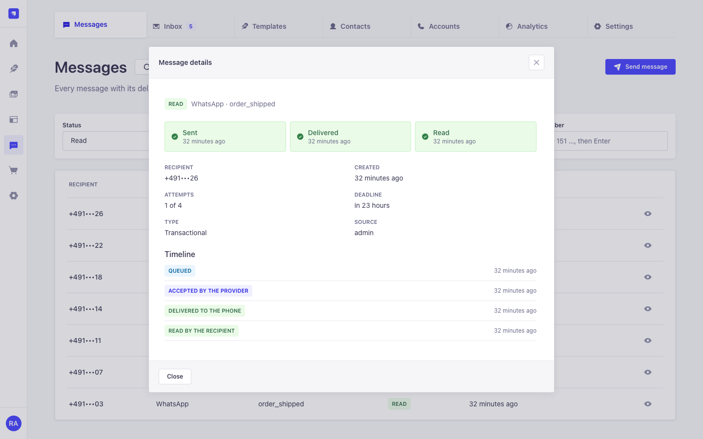

## Features

- **Four channels, one API.** WhatsApp through Meta's Cloud API, RCS through Twilio, Telegram through the Bot API, SMS through seven.io or Twilio. No vendor SDKs; each provider is a small HTTPS client.
- **Templates with variables and buttons.** An editor with a live preview for WhatsApp, RCS rich cards, Telegram and SMS (including the SMS part count). WhatsApp templates (also with image, video or PDF headers) are submitted to Meta from Strapi; RCS cards become Twilio Content templates.
- **Attachments.** Send a PDF, image or video from the media library or a public https URL. WhatsApp, RCS and Telegram carry the file; SMS gets a short signed download link that expires.
- **Inbox.** Replies, button taps, photos, documents, voice notes and locations arrive as an exactly-once event. Files are downloaded, checked (size, type, content) and stored in the media library. Answer from code or from the admin inbox.
- **Testable.** A dry run shows the route and the rendered message without sending; a sandbox mode with magic test numbers runs your app tests without network or cost.
- **Exactly once.** A durable outbox in your database. Each message is sent once, also with several Strapi processes, and the same `idempotencyKey` never sends twice.
- **Delivery and read tracking.** Every message has a timeline: queued → sent → delivered → read, or failed with a reason in plain language.
- **Fallback chain.** WhatsApp → RCS → SMS. A number that isn't on WhatsApp or can't receive RCS is remembered, so the next message skips that channel. E-mail through [Magic Mail](https://github.com/Schero94/Magic-Mail) is an opt-in last step and off by default; MessageGate never sends e-mail itself.
- **Routing rules.** Choose the channel order per template, tag or country.
- **Consent built in.** Consent per channel, STOP keywords (`STOP`, `STOPP`, `ABMELDEN`, `UNSUBSCRIBE`, editable), GDPR export and erasure per contact.
- **Number checks.** A free format check (valid, mobile or landline), plus optional paid checks with a shared cache and monthly budget: Twilio line type and seven.io HLR (is the number assigned?). Sends to unassigned numbers can stop before they cost anything.
- **Safe retries.** Retries after about 1, 5 and 15 minutes, only when the provider provably did not take the message. When the outcome is unknown, the message becomes _uncertain_ and an admin decides, instead of risking a duplicate.
- **An admin that looks like Strapi.** Built only from the Strapi Design System, in English, German, French, Spanish and Portuguese, light and dark, down to phone width.
- **Ready for several instances.** Tested with 8 processes on one PostgreSQL database (Railway replicas, pm2 cluster mode).

## What the official APIs allow

People often ask for things that WhatsApp, Telegram and SMS providers don't offer. Here is what is possible:

| Question                | WhatsApp (Cloud API)                                                                  | Telegram (Bot API)                   | SMS                        | What MessageGate does                                                                                                     |
| ----------------------- | ------------------------------------------------------------------------------------- | ------------------------------------ | -------------------------- | ------------------------------------------------------------------------------------------------------------------------- |
| Does the number exist?  | No check before sending. The first send tells you: error 131026 means not on WhatsApp | Only for people who started your bot | Paid carrier lookups exist | Free format check; optional Twilio line-type lookup (cached, budget-capped); learns "not on WhatsApp" from the first send |
| Is the person online?   | Not available                                                                         | Not available                        | Not available              | Shows the **last activity** instead: last reply, last delivery, last read                                                 |
| Has the person read it? | Yes, a `read` status, unless the recipient turned read receipts off                   | No read receipts for bots            | Delivery receipt only      | A timeline per message and a read rate per template; read rates are a lower bound                                         |
| Can it receive RCS?     | –                                                                                     | –                                    | –                          | Twilio has no RCS check. MessageGate sends with RCS and learns from error 63036, then falls back to SMS                   |
| Is the number active?   | –                                                                                     | –                                    | HLR lookups (paid)         | Optional seven.io HLR check, cached; can stop sends to unassigned numbers (`NUMBER_INACTIVE`)                             |

## Quick start

1. Install:

   ```bash
   npm install strapi-plugin-magic-messagegate
   ```

2. Configure the plugin in `config/plugins.js`:

   ```js
   module.exports = ({ env }) => ({
     'magic-messagegate': {
       enabled: true,
       config: {
         encryptionKey: env('MESSAGEGATE_ENCRYPTION_KEY'), // 16+ characters, never change it later
         publicUrl: env('PUBLIC_URL'), // https://cms.example.com, used for webhook URLs
       },
     },
   });
   ```

3. Build and start Strapi, then open **MessageGate** in the admin menu.
4. **Accounts → Connect a channel.** SMS or Telegram are the quickest for a first test; WhatsApp needs a Meta app (see below).
5. **Templates → Create template**, then send it from **Messages → Send message**, or from code:

   ```js
   await strapi
     .plugin('magic-messagegate')
     .service('messages')
     .send({
       to: '+4915123456789',
       template: 'order_shipped',
       language: 'de',
       variables: { first_name: 'Anna', order_id: 'A-10423' },
       idempotencyKey: 'order-shipped-A-10423',
     });
   ```

Requirements: Strapi `^5.38.0`, Node.js `^22.21.0 || >=24.9.0`, PostgreSQL, MySQL 8 or SQLite.

Without `encryptionKey`, MessageGate falls back to `MESSAGEGATE_ENCRYPTION_KEY`, then `APP_KEYS`, then `ADMIN_JWT_SECRET`. If the key changes later, stored secrets and phone numbers can no longer be read.

## Screenshots

|                                                                                                                  |                                                                                                                                  |
| ---------------------------------------------------------------------------------------------------------------- | -------------------------------------------------------------------------------------------------------------------------------- |
| 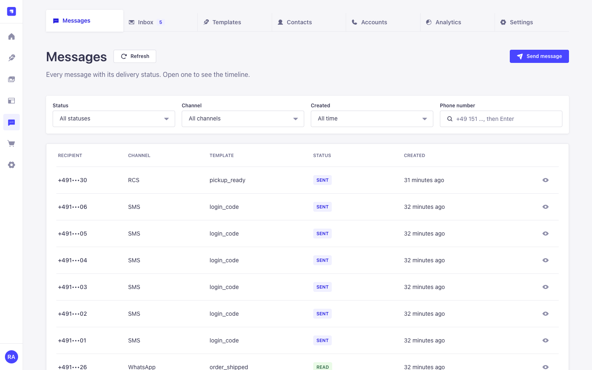                 | 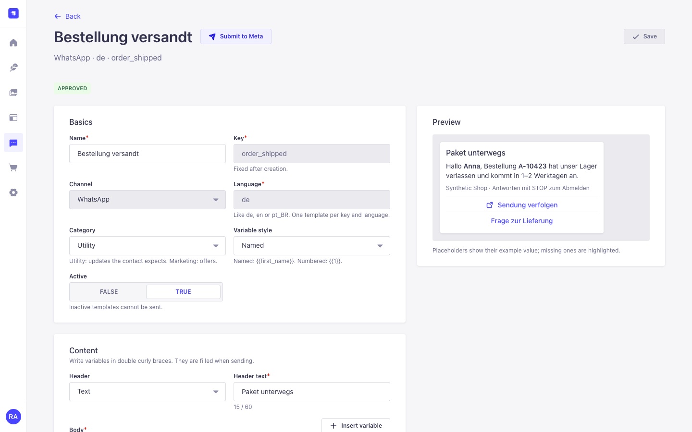 |
| Messages with status, channel and filters                                                                        | Template editor with a live WhatsApp preview                                                                                     |
| 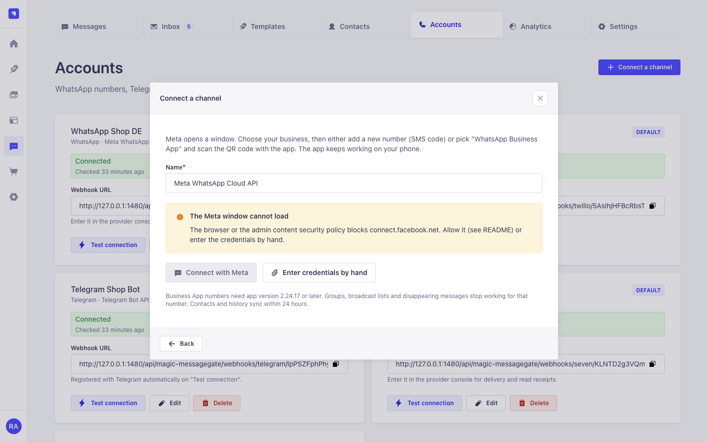 | 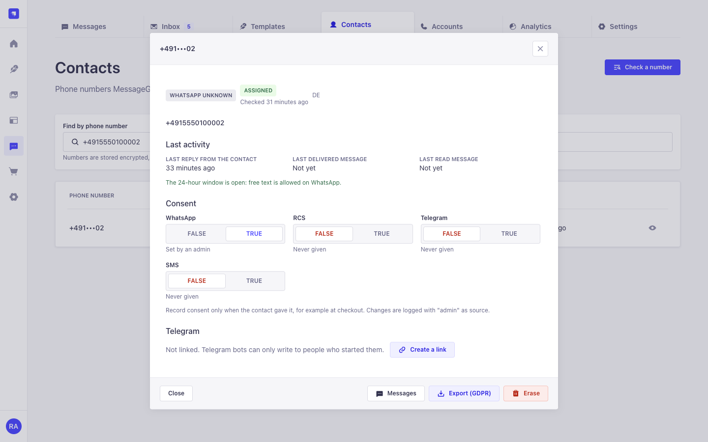                    |
| Connect WhatsApp through Meta, including the Business App QR path                                                | A contact with consent, reachability and last activity                                                                           |
| 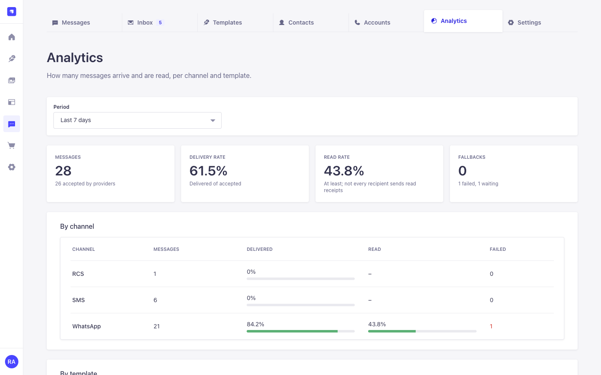               | 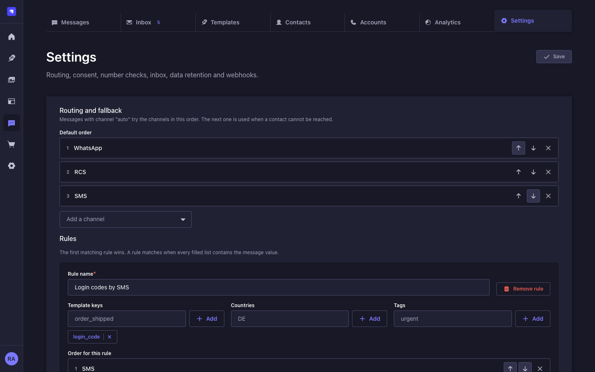               |
| Delivery and read rates per channel and template                                                                 | Routing, fallback, consent and retention (dark mode)                                                                             |

| 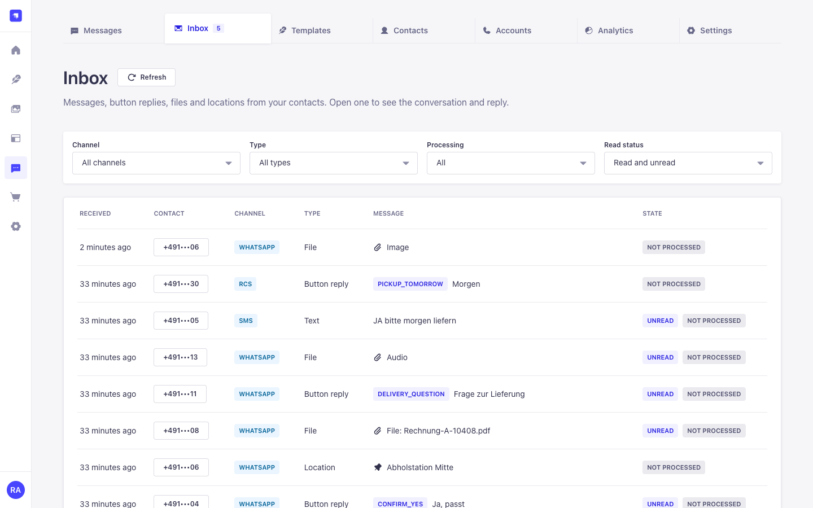 | 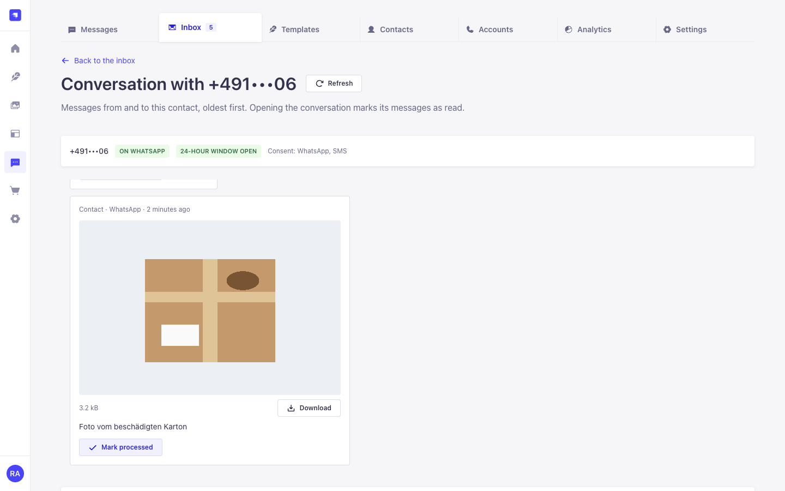 |
| Inbox with buttons, files and locations from every channel | A conversation: inbound photo, location and the reply box |
| 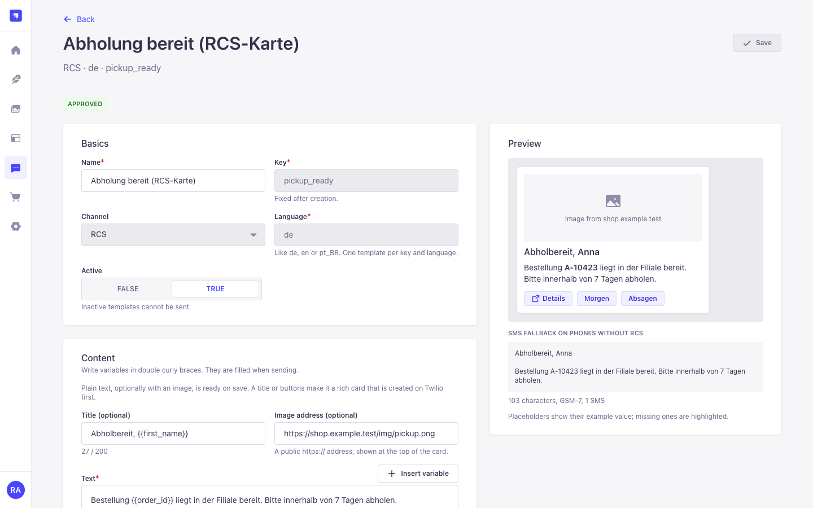 | 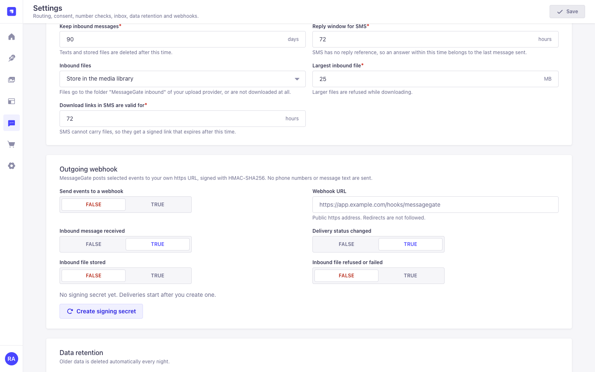 |
| RCS rich card with buttons, created on Twilio | Inbox, inbound files and the signed outgoing webhook |

Every screen in light, dark and phone width is in [`pics/`](./pics).

## Connect your channels

### WhatsApp (Meta Cloud API)

What the account owner sets up once at Meta:

1. A **Meta business portfolio** and a **Meta app** with the WhatsApp product. **Business verification** raises your sending limits.
2. A **phone number**: a new number for the API, or your existing **WhatsApp Business App** number. Meta calls the second option _coexistence_: you keep using the app on your phone, and Strapi sends through the API.
3. A payment method in WhatsApp Manager. Meta charges per delivered template message, by category (marketing, utility, authentication); see [Meta's pricing page](https://developers.facebook.com/docs/whatsapp/pricing).

Then, in **Accounts → Connect a channel → WhatsApp**, pick one of two ways:

- **Connect with Meta (Embedded Signup).** Opens Meta's own window. Choose a new number, or choose the WhatsApp Business App and scan the QR code with the app. MessageGate exchanges the code for a token on the server and subscribes your app to the number. Server config:

  ```js
  config: {
    providers: {
      meta: {
        embeddedSignup: {
          appId: env('META_APP_ID'),
          configId: env('META_SIGNUP_CONFIG_ID'),
          appSecret: env('META_APP_SECRET'),
          verifyToken: env('META_WEBHOOK_VERIFY_TOKEN'), // 16-128 characters: A-Z a-z 0-9 _ -
        },
      },
    },
  },
  ```

  In the Meta app, set the webhook callback URL to `https://<your-cms>/api/magic-messagegate/webhooks/meta/app` with the same verify token, and subscribe to the `messages` and `message_template_status_update` fields.

  Strapi's content security policy blocks Meta's script by default. Allow it in `config/middlewares.js`:

  ```js
  {
    name: 'strapi::security',
    config: {
      contentSecurityPolicy: {
        useDefaults: true,
        directives: {
          'script-src': ["'self'", 'https://connect.facebook.net'],
          'frame-src': ["'self'", 'https://www.facebook.com', 'https://web.facebook.com'],
        },
      },
    },
  },
  ```

  If the Meta window can't load, the wizard says so and offers the manual path.

- **Enter credentials manually.** Paste the access token, phone number ID, WhatsApp Business Account ID and app secret. MessageGate then shows the webhook URL and verify token to copy into the Meta app.

### Telegram

1. Open [@BotFather](https://t.me/BotFather), create a bot and copy its token.
2. Paste the token in **Accounts → Connect a channel → Telegram**. MessageGate registers the webhook with a secret token.
3. A bot can't message someone by phone number. People link their chat through a one-time link (`https://t.me/<your_bot>?start=…`, valid for 30 minutes) that you create in **Contacts** or from code with `service('telegram').createLink(contactId)`.

### SMS (seven.io or Twilio)

- **seven.io**: API key, signing key for status reports, sender ID. The same account can run the paid HLR check.
- **Twilio**: account SID, auth token, and a sender number or messaging service. The same account can run the paid line-type lookup.

Copy the webhook URL shown for the account into the provider's status and inbound settings so delivery receipts and replies arrive.

### RCS (Twilio)

1. Get an RCS sender approved in the Twilio Console and add it to a **Messaging Service**.
2. **Accounts → Connect a channel → RCS**: account SID, auth token and the Messaging Service SID. Leave "Let Twilio fall back to SMS" off, so MessageGate's chain decides (WhatsApp → RCS → SMS) and every step has its own timeline.
3. Set the account's webhook URL as the Messaging Service's status callback and incoming-message URL.
4. Grant `rcs` consent for contacts like for the other channels. Plain RCS text templates work at once; rich cards with a title, image and buttons need **Create on Twilio** in the template editor.

Twilio offers no "can this number receive RCS" check. MessageGate tries RCS and remembers error 63036 (not RCS capable) for 30 days.

## Sending messages

### From Strapi code

```js
const messages = strapi.plugin('magic-messagegate').service('messages');

// An order update: WhatsApp first, SMS if the number isn't on WhatsApp.
const { id, status, channel, duplicate } = await messages.send({
  to: '+4915123456789',
  template: 'order_shipped',
  language: 'de',
  variables: { first_name: 'Anna', order_id: 'A-10423' },
  idempotencyKey: 'order-shipped-A-10423',
});

// A login code: an AUTHENTICATION template with transactional: true
// needs no marketing consent, and it is dropped if it can't go out in time.
await messages.send({
  to: '+4915123456789',
  channel: 'sms',
  template: 'login_code',
  variables: { code: '482913' },
  transactional: true,
  notAfter: new Date(Date.now() + 10 * 60_000),
  idempotencyKey: `login-${sessionId}`,
});

const detail = await messages.get(id); // status, timeline, fallbacks
```

**Attachments.** Add `attachment: { fileId }` (media library) or `attachment: { url: 'https://…', mimeType: 'application/pdf' }`. JPEG, PNG, PDF and MP4 are allowed. WhatsApp, RCS and Telegram send the file; SMS gets a signed link valid for 72 hours (Settings → Inbox and files). A channel that can't carry the file (too large, wrong type) is skipped. Only a reference is stored, never the file.

**Dry run.** `messages.send(input, { dryRun: true })` returns the channel chain, which channels can be used and why not, the account and the rendered payload, without sending or charging anything. Handy in tests and before a campaign.

**Variables in WhatsApp buttons.** A URL button can end in one variable, for example `https://shop.example/track/{{order_id}}`. Pass only the suffix (`order_id: 'A-10423'`); WhatsApp appends it to the URL Meta approved, so a variable can never point the button at another site. Copy-code buttons take their value from `variables` too (at most 15 characters).

### From another service (Content API)

Create a Strapi API token (Settings → API Tokens) with the MessageGate permissions, then:

```bash
curl -X POST https://cms.example.com/api/magic-messagegate/messages \
  -H "Authorization: Bearer $STRAPI_API_TOKEN" \
  -H "Content-Type: application/json" \
  -d '{"data":{"to":"+4915123456789","template":"order_shipped","language":"de","variables":{"first_name":"Anna","order_id":"A-10423"},"idempotencyKey":"order-shipped-A-10423"}}'
```

| Method | Path                                              | Purpose                                    |
| ------ | ------------------------------------------------- | ------------------------------------------ |
| POST   | `/api/magic-messagegate/messages`                 | send (202 new, 200 duplicate)              |
| GET    | `/api/magic-messagegate/messages/:id`             | status and timeline                        |
| POST   | `/api/magic-messagegate/consent`                  | record or revoke consent                   |
| POST   | `/api/magic-messagegate/telegram-link`            | create a Telegram link for a phone number  |
| POST   | `/api/magic-messagegate/lookup`                   | check a number (`hlr: true` for HLR)       |
| POST   | `/api/magic-messagegate/capabilities`             | free summary: valid, active, WhatsApp, RCS |
| POST   | `/api/magic-messagegate/templates/render`         | render a template without sending          |
| GET    | `/api/magic-messagegate/inbound`                  | inbound messages (separate permission)     |
| GET    | `/api/magic-messagegate/inbound/:id/media`        | an inbound file (or `?as=base64`)          |
| POST   | `/api/magic-messagegate/inbound/:id/reply`        | answer on the same channel                 |
| GET    | `/api/magic-messagegate/conversations/:contactId` | inbound and outbound history               |

The Content API only accepts API tokens. Users-permissions logins are refused, because these routes act on any phone number. Set `contentApi.allowUsersPermissions: true` only if you add your own checks.

The full contract (every field, status, event and error code) is in [AGENTS.md](./AGENTS.md).

### Events

React to deliveries without polling. Payloads carry no phone numbers and no message text:

```js
strapi.eventHub.on('messagegate.message.failed', ({ messageId, channel, code }) => {
  strapi.log.warn(`Message ${messageId} on ${channel} failed: ${code}`);
});
```

Events: `messagegate.message.queued`, `.sent`, `.delivered`, `.read`, `.failed`, `.uncertain`, `.expired`, `.discarded`, `.fallback`, `.received`, plus `messagegate.media.ready`, `messagegate.media.failed`, `messagegate.contact.opted-out`, `messagegate.contact.unreachable` and `messagegate.template.status-changed`. Every event is emitted by exactly one process. The same events can go to your own https endpoint, signed with HMAC-SHA256 (Settings → Outgoing webhook; verification code in [AGENTS.md](./AGENTS.md#outgoing-webhook)).

## Receiving messages

Every reply, button tap, photo, document, voice note or location arrives once as `messagegate.message.received`. Text, captions and files are stored encrypted or in your media library, never in the event.

### Access inbound messages and files from your code

```js
const mg = strapi.plugin('magic-messagegate');

mg.service('inbound').onReceived(async ({ inboundId, kind, buttonPayload }) => {
  const message = await mg.service('inbound').get(inboundId); // text, button, location, media status
  if (kind === 'media' && message.media.status === 'ready') {
    const file = await mg.service('inbound').getMedia(inboundId, { as: 'buffer' }); // or 'stream', 'base64'
    // or a signed URL for a service that fetches files: inbound.createMediaUrl(inboundId, { ttlSeconds: 300 })
  }
  const { items } = await mg.service('conversations').history({ inboundId }); // inbound and outbound, in order
  await mg.service('messages').reply(inboundId, { text: 'Thanks, we are on it.' });
  await mg.service('inbound').markProcessed(inboundId); // idempotent: alreadyProcessed on later calls
});
```

Files arrive a moment later than the message: wait for `messagegate.media.ready` (or check `media.status`). The data can be passed to any processing of your own. Do the work after the event, not inside it, and don't log message text.

### Recipes

**Appointment confirm or cancel with buttons.** Send a template with two quick-reply buttons (payloads `appt_yes`, `appt_cancel`; Telegram: inline buttons; RCS: suggested replies). Then:

```js
strapi.eventHub.on('messagegate.message.received', async ({ inboundId, buttonPayload, replyTo }) => {
  if (!buttonPayload?.startsWith('appt_')) return;
  const appointment = await findAppointmentByMessage(replyTo); // replyTo = the message with the buttons
  await (buttonPayload === 'appt_yes' ? confirm(appointment) : cancel(appointment));
  await strapi.plugin('magic-messagegate').service('inbound').markProcessed(inboundId);
});
```

**Support auto-reply and keyword routing.** Look at `message.text` (`inbound.get`), route keywords (`RECHNUNG`, `TERMIN`) to your own handlers and answer with `messages.reply(inboundId, { text })`. On WhatsApp, free text only works within 24 hours of the customer's last message; after that, `reply` fails with `WINDOW_CLOSED` and you send a template instead (`{ template, variables }`).

**Receipt photo → order.** On `messagegate.media.ready`, load the file with `inbound.getMedia(inboundId)` (or link the media library file by `fileId`) and attach it to the order the conversation belongs to (`history` or `replyTo`).

**Voice note → support.** `media.mime` is `audio/ogg` with `duration`; forward `inbound.createMediaUrl(inboundId)` (5 minutes) to your support tool instead of the file itself.

**Idempotent worker.** Process `GET /api/magic-messagegate/inbound?processed=false` in a loop and call `POST /inbound/:id/processed`; `alreadyProcessed: true` tells a second worker to skip.

**Virus scan.** Register a scanner in every process (for example in your app's `bootstrap`); files stay in quarantine, not stored, until it answers `clean`:

```js
strapi
  .plugin('magic-messagegate')
  .service('inbound')
  .onMediaScan(async ({ bytes, mime }) => {
    return (await myScanner.scan(bytes)) ? 'clean' : 'infected';
  });
```

**External consumer.** Turn on Settings → Outgoing webhook, copy the signing secret once and check `X-MessageGate-Signature` as shown in [AGENTS.md](./AGENTS.md#outgoing-webhook). Deliveries carry ids and statuses only; fetch the text with the Content API.

**Login link through Magic Link.** Create the token with [Magic Link](https://github.com/Schero94/Magic-Link) (`createToken`) and send its login URL by SMS or Telegram as a template variable. WhatsApp only allows login **codes** in `AUTHENTICATION` templates, not links, so send the code there (`transactional: true`).

### Inbound files: limits, storage and privacy

| Provider | Retrievable for                          | Size limit                                 | Notes                                                 |
| -------- | ---------------------------------------- | ------------------------------------------ | ----------------------------------------------------- |
| WhatsApp | 7 days                                   | 100 MB from customers (Meta), your `maxMb` | downloaded with the access token; URL valid 5 minutes |
| Telegram | 24 hours (MessageGate retries that long) | 20 MB (Bot API `getFile`), your `maxMb`    | photos, documents, voice notes, videos, stickers      |
| Twilio   | until deleted                            | your `maxMb`                               | basic auth; SMS (MMS) and RCS                         |
| seven.io | –                                        | –                                          | inbound SMS text only (no media documented)           |

Downloads stop at `inboundMedia.maxMb` (25 MB) while streaming, accept only allowed types, compare the first bytes with the type, remove EXIF location data from JPEG and PNG, and store the file in the media library folder **MessageGate inbound** (works with S3, Cloudinary and every other upload provider). Set **Inbound files → Do not store** to keep only metadata. Inbound messages and their files are deleted after 90 days (Settings → Inbox and files) and with a GDPR erasure; the GDPR export includes them.

## Configuration

`config/plugins.js` holds the infrastructure settings. Business settings are edited in **MessageGate → Settings** and stored in the database.

| Option                                    | Default                   | Description                                                           |
| ----------------------------------------- | ------------------------- | --------------------------------------------------------------------- |
| `encryptionKey`                           | env fallback (see above)  | Key for secrets and phone numbers at rest                             |
| `publicUrl`                               | `server.url`              | Public base URL used to build webhook URLs                            |
| `defaultCountry`                          | `DE`                      | Country for numbers written without `+`                               |
| `defaultNotAfterHours`                    | `24`                      | Deadline for messages without `notAfter`                              |
| `worker.enabled`                          | `true`                    | Set `false` on a process that should not send (for example web-only)  |
| `worker.intervalMs`                       | `5000`                    | How often each process looks for due messages                         |
| `worker.batchSize` / `worker.concurrency` | `10` / `2`                | Messages per claim / sent in parallel per process                     |
| `worker.leaseMs`                          | `120000`                  | How long a claimed message stays reserved                             |
| `retry.delaysMs`                          | `[60000, 300000, 900000]` | Waits before retries 1 to 3                                           |
| `retry.jitter`                            | `0.2`                     | Random spread of the waits (±20 %)                                    |
| `contentApi.allowUsersPermissions`        | `false`                   | Let users-permissions logins call the Content API                     |
| `rateLimits.sendPerMinute`                | `120`                     | Content API sends per API token, shared by all processes              |
| `rateLimits.lookupPerMinute`              | `30`                      | Content API lookups per caller                                        |
| `rateLimits.webhookPerMinute`             | `1200`                    | Webhook requests per account                                          |
| `rateLimits.adminWritePerMinute`          | `60`                      | Admin write actions per admin user                                    |
| `rateLimits.inboundPerMinute`             | `300`                     | Content API reads of inbound messages and files per token             |
| `rateLimits.downloadPerMinute`            | `60`                      | Signed file downloads per IP                                          |
| `providers.mode`                          | `live`                    | `sandbox`: in-process fake providers for tests (see below)            |
| `outgoingWebhooks.allowPrivateHosts`      | `false`                   | Development only: allow a local outgoing webhook receiver             |
| `providers.meta.graphVersion`             | built in                  | Pin a Graph API version, for example `v23.0`                          |
| `providers.meta.embeddedSignup`           | none                      | `appId`, `configId`, `appSecret`, `verifyToken` for Connect with Meta |
| `providers.<name>.timeoutMs`              | built in                  | Request timeout per provider (100 to 60000)                           |

**Settings page** (defaults in brackets): default country (DE), consent required (on), opt-out keywords, default channel chain (WhatsApp → RCS → SMS; installs from 1.0 keep their saved chain), up to 50 routing rules by template, tag or country, e-mail fallback through Magic Mail (off), paid lookups: Twilio line type and seven.io HLR (off, 30-day cache, 500 per month), stop sends to unassigned numbers (off), inbox retention (90 days), SMS reply window (72 hours), inbound files (media library, 25 MB), SMS download links (72 hours), outgoing webhook (off), retention (messages 90 days, webhook receipts 7 days).

### Sandbox for tests and CI

```js
// config/env/test/plugins.js
const { sandboxConfig } = require('strapi-plugin-magic-messagegate/testing');
module.exports = { 'magic-messagegate': { enabled: true, config: sandboxConfig() } };
```

In sandbox mode no message leaves the server. Test numbers decide the outcome: `+4915550000002` is read, `+4915550000003` is not on WhatsApp (falls back), `+4915550000004` can't receive RCS, `+4915550000005` stays undelivered, `+4915550000007` ends uncertain, `+4915550000008` is an unassigned number; every other number is delivered. `sandbox.simulateInbound({ to, text, buttonPayload, media: { mime, size } })` (or `POST /api/magic-messagegate/sandbox/inbound`) feeds replies and files into your automations, and `drain(strapi)` runs the workers right away. The full table is in [AGENTS.md](./AGENTS.md#sandbox-tests-and-ci).

## Permissions

Settings → Administration Panel → Roles → Plugins → Magic MessageGate:

| Permission               | Allows                                                   |
| ------------------------ | -------------------------------------------------------- |
| Accounts: read / manage  | see accounts / connect, edit, test and delete them       |
| Templates: read / manage | see and preview templates / create, edit and delete them |
| Templates: submit        | send WhatsApp templates to Meta for approval             |
| Messages: read / send    | see messages and timelines / send from the admin         |
| Messages: manage         | retry, discard, mark as sent                             |
| Inbox: read              | see inbound messages, files and conversations            |
| Inbox: manage            | mark inbound messages as processed                       |
| Contacts: read           | see contacts, run the free number check                  |
| Contacts: manage         | change consent, link Telegram, erase, run paid lookups   |
| Contacts: export         | GDPR export of a contact                                 |
| Analytics: read          | see analytics                                            |
| Settings: read / update  | see / change the settings                                |

For the Content API, tick the MessageGate actions on the API token. The inbound routes (text and files) are separate actions (`inbound-api`), so a token that only sends cannot read replies.

## Consent and privacy

- Sending needs granted consent for the channel. The exception is an `AUTHENTICATION` template sent with `transactional: true` (login codes).
- An opt-out keyword in an incoming WhatsApp, SMS or Telegram message revokes consent for that channel right away, for every process.
- Phone numbers and Telegram chat IDs are stored encrypted and looked up by a keyed hash. Logs only show a short hash prefix, events show none.
- Inbound text, captions and locations are stored encrypted; inbound files go to the media library. Both are deleted after the inbox retention period.
- Messages and their events are deleted after the retention period; outbound message content is removed as soon as a message is delivered.
- **Contacts → Export** returns everything stored about one person, including inbound messages; **Erase** deletes it, including inbound files.
- `metadata` and `tags` are stored in plain text. Don't put personal data there.

## Security

- Every admin route needs an admin session and a MessageGate permission. The Content API needs an API token.
- Provider secrets are encrypted and never returned by the API; the admin only shows whether a secret is set.
- Webhooks use an unguessable URL per account plus the provider's signature: Meta `X-Hub-Signature-256`, the Telegram secret token, the seven.io signature with timestamp and nonce, the Twilio signature. Repeated deliveries are ignored. Failures answer `401` without detail.
- Template variables are plain text with length limits; control characters are removed and Telegram HTML is escaped.
- MessageGate never fetches a URL from user input. Attachment URLs must be public https URLs (no private, loopback or link-local hosts, no credentials) and are passed to the provider; SMS links to them are redirects. Inbound files are downloaded only from the provider's own hosts, with a size cap while streaming, a type allow-list and a check of the first bytes. The outgoing webhook URL is checked against the same rules before every delivery.
- Signed download links and media URLs carry an HMAC and an expiry; every invalid link gets the same `404`, and downloads are rate limited per IP. Files are served as downloads with `nosniff` and a sandboxing CSP.
- Request bodies, variables (50 per message), metadata keys (20), page sizes and search terms are bounded. Rate limits are counted in the database, so they hold across processes.
- Two runtime dependencies: `zod` and `libphonenumber-js`. 1.1 adds none.

Please report vulnerabilities privately through [GitHub security advisories](https://github.com/Schero94/Magic-MessageGate/security/advisories/new).

## Running several instances

MessageGate keeps its state in the database, so any number of Strapi processes can share it (Railway replicas, pm2 cluster mode, Kubernetes):

- The outbox claims messages with `FOR UPDATE SKIP LOCKED` on PostgreSQL and MySQL 8, and with a conditional update on SQLite, so each message is sent by exactly one process.
- Rate limits, the lookup budget and its cache, webhook de-duplication, inbound messages (unique per provider message id), media download jobs, outgoing webhook deliveries and maintenance jobs use shared database rows, so each event and each download happens once.
- Webhooks can reach any process. No sticky sessions are needed.

The test: 8 processes on one PostgreSQL database behind a round-robin balancer sent 500 messages with 0 duplicates. Status webhooks sent in random order to random processes all ended as `read`, and a STOP received by one process blocked the next send on another ([record](./docs/acceptance/2026-11-11-cluster.md)).

Strapi creates and changes database tables at startup. For the first deploy, and for updates that change tables, start **one** replica first, then scale up.

## Costs

MessageGate is free (MIT). The providers charge you: Meta per delivered WhatsApp template message ([pricing](https://developers.facebook.com/docs/whatsapp/pricing)), Twilio per RCS message, seven.io or Twilio per SMS, Twilio per line-type lookup ([Lookup pricing](https://www.twilio.com/en-us/user-authentication-identity/pricing/lookup)) and seven.io per HLR check (0.01 EUR on the [seven.io price list](https://www.seven.io/en/prices/)). Lookups are cached for 30 days, and the monthly budget stops them when it is used up. Telegram is free. The sandbox costs nothing.

## FAQ

**Can MessageGate check whether a number has WhatsApp or RCS before sending?**
No. Neither Meta's Cloud API nor Twilio has such a check. MessageGate learns it from the first send and falls back to the next channel. Unofficial WhatsApp checks are not used.

**Does MessageGate send e-mail?**
No. E-mail is an opt-in last step of the chain that hands the message to Magic Mail; it is off by default.

**Why is a message "uncertain"?**
The request reached the provider, but no clear answer came back in time. The provider may or may not have the message, so sending again could deliver it twice. An admin can retry it (after confirming the risk) or mark it as sent.

**Can I send free text on WhatsApp?**
Only within 24 hours after the contact last wrote to you. Outside that window, Meta requires an approved template.

**Do I need Magic Mail?**
No. It is only used for the optional, off-by-default e-mail step of the fallback chain.

**Can I connect my personal WhatsApp number?**
No. Only a WhatsApp Business App number (coexistence) or a new number can be connected through the official API.

## Migrating from Magic WhatsApp

`strapi-plugin-magic-whatsapp` drove WhatsApp Web through the unofficial `baileys` library and a QR session. That breaks WhatsApp's terms and puts numbers at risk of a ban, so it is gone. MessageGate is a new plugin (`magic-messagegate`) with new routes, permissions and tables; the old package was never published to npm. To move over:

1. Remove the old plugin from `package.json` and `config/plugins.js`, and delete its `.whatsapp-auth` folder.
2. Install MessageGate and connect your number through Meta (the Business App number works through coexistence).
3. Recreate your templates and submit the WhatsApp ones to Meta.

Details are in the [changelog](./CHANGELOG.md).

## For AI agents

[AGENTS.md](./AGENTS.md) is the exact API contract for coding agents. The docs site also serves [`llms.txt`](https://schero94.github.io/Magic-MessageGate/llms.txt) and [`llms-full.txt`](https://schero94.github.io/Magic-MessageGate/llms-full.txt).

## Contributing

```bash
npm ci
npm run lint && npm run format:check
npm test          # unit tests, provider contract tests with local fakes, 8 processes on SQLite
npm run test:pg   # 8 processes on PostgreSQL (set MG_TEST_PG_URL)
npm run build && npm run verify
```

Issues and pull requests are welcome at [github.com/Schero94/Magic-MessageGate](https://github.com/Schero94/Magic-MessageGate/issues). See [CONTRIBUTING.md](./CONTRIBUTING.md) for the checks, the 8-process acceptance run and releases; the design decisions are in [CONCEPT.md](./CONCEPT.md).

## License

[MIT](./LICENSE)
